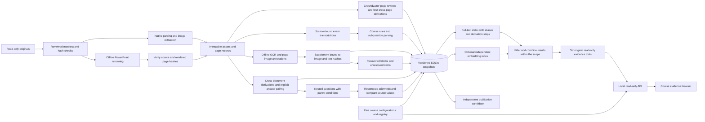

# Course data and evidence retrieval

ExamSage turns authorized files into versioned course snapshots. Each answer can point back to the document and physical page that support it. The data flow below shows the original five-course evidence browser and its pilot-specific extensions. The downloadable student app adds personal import, the study conversation and saved review pages. [Student app and current implementation](../README.md)

## Records and snapshots

- A `Document` distinguishes content date, teaching year and demonstrated availability. A `Page` records text, speaker notes, visibility, visual review and extraction gaps.
- A `Record` represents a passage, concept, formula, example, question or answer and carries a `SourceRef`. A `Relation` records provenance and whether the relation is explicit or inferred.
- A `Scope` names the workspace, course, snapshot, permitted sources and time filter.

The snapshot ID digests the documents, structured records, relationships and processing metadata. Changes to a source or course configuration produce a new snapshot. Older snapshots remain readable. The parser cache reuses unchanged inputs. A publication transaction creates the complete versioned snapshot.

An exam transcription must match the source SHA-256, page and original excerpt. Rules apply to a copy of the page. The original question and shared parent prompt remain available, and the build checks that question numbers and marks are preserved. Stale transcription rules fail the build. Their digest is recorded in snapshot metadata. The label `agent_source_checked` records comparison with the specified original page by an agent. Independent academic review has a separate status.

Full-slide rendering verifies the source hash, slide count, hidden-slide status, PNG dimensions and image hashes. PowerPoint runs during offline preparation. The API serves verified PNGs. Review notes depend on the source and image hashes, so changed images require fresh review. Native text is retained separately. Animation is represented by a static composite. The original presentation is needed to replay its sequence.

## Course isolation and publication

Each course is mounted separately. Its store and scope constrain snapshots, allowed sources, Chinese search aliases and search results. Groundwater (GRT) has a dedicated configuration. The other four pilot courses use `source_pages` mode and their own assessment structures. A batch library build records per-course errors and returns a nonzero exit code if any course fails. The existing registry is retained, although an individual course that built successfully may have a new snapshot. This batch command does not provide a cross-course transaction.

Publication checks original files, complete slide images and supplemental images. The scoped export has its own database and assets. It includes records whose sources are authorized and whose parent-question context is complete, and retains processing metadata. Pilot and answer-pairing statistics are recomputed for the exported scope.

## Retrieval and student visibility

Validate workspace, course and snapshot before retrieval. A compound record is visible only when all referenced sources are authorized. Expanding a relationship verifies both endpoints and the relation's own references. Student search excludes hidden material and speaker notes by default. Strict historical queries exclude sources whose availability date is unknown.

Keyword queries use SQLite FTS5, including Chinese character pairs, course aliases and derivation steps. Exact question numbers use structured fields. Optional embedding stores are isolated by snapshot and model route. Context is assembled from whole records. A subquestion and its parent conditions travel together. If the group exceeds the budget, the response reports the omitted group.

If a requested year, question or part is missing, return insufficient evidence for that item. Check each requested year separately. The original question extraction is available for comparison with the transcription. Structured results carry references and do not repeat the entire source page for every concept. Fetch the full page on demand with `get_source_page`.

## Questions, answers and numerical checks

In `source_pages` mode, students can retrieve document pages. Explicit pilots add structured evidence. Sustainable Electrical Systems (SES) pairs questions and answers after checking source hashes, document types, year evidence, question number, subquestion path and the identities of both paired documents. A path such as `a.b.ii` retains its levels. A year-and-topic query stays within that year. The source label determines how an academic year is interpreted.

`get_question` and `get_answer` return all ancestors, and the browser retains the common prompt during child navigation. The requested part's complete calculation, inherited conditions and sources stay together. A shared question-and-answer audit is returned once. Other parent calculations are available on demand. Oversized groups are omitted with a notice.

Recalculation allows a restricted arithmetic syntax tree, finite scalar values and specified mathematical functions. The build recomputes the expression and records `computed_value` and a comparison of `agrees`, `mismatch` or `not_reported`. It ignores a self-reported computed result. Academic review independently uses `checked`, `source_conflict` or `partial`. Matching arithmetic alone cannot establish the physical assumptions or resolve a source error.

A joint audit also depends on the answer source. When the scope excludes that source, reading and exporting remove the joint audit, `mapping_evidence` and its source warnings. A parent guide may include clues from the answer, so restricted responses use `source_question_text` bound to the original question page. An older snapshot lacking that field directs the student to the original paper. The original snapshot stays intact, and a restricted export preserves the safe question wording. Counts and availability indicators are refreshed for the active scope.

## Low-text pages and visual evidence

Preserve native text, OCR candidates, agent guide notes and recovered blocks separately. OCR below confidence 70 is excluded from the searchable text. Recovered blocks identify text, equations, diagrams or tables. Unresolved items require `partially_legible` status. Import, media delivery and publication verify supplemental image hashes. When several matching pages belong to one derivation, retrieval gives the complete derivation priority over isolated fragments.

PDF previews serialize PDFium access using a process-local lock. The renderer writes a temporary PNG then replaces the destination atomically to protect concurrent readers. Browsers label a transcription as page-checked only when its requisite metadata is complete. An ordinary equation note does not trigger that label. Local KaTeX renders mathematics, and tables use safe text nodes. View updates and original-page previews use request sequence numbers so a stale response cannot replace a newer selection.

## Interpreting results and extending the service

The system separately records extraction, structural validation, source comparison and independent expert acceptance. Course interpretations and inferred relationships remain candidates pending academic review. A successful page-retrieval evaluation establishes that the expected page was found. Correctness of an academic conclusion or of an exam forecast requires its own evaluation.

A hosted version could retain the data contracts while replacing local store and asset implementations, adding authentication and persistent job execution. A conversation agent can call the same scoped, read-only tools. Future course-discovery and multimodal extraction features should produce candidate records and validate their sources before publication in a new snapshot.
