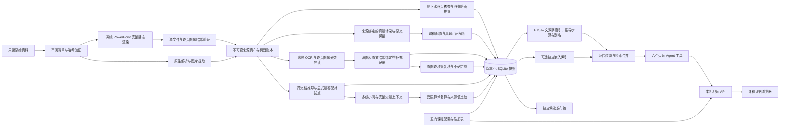

# v2 数据与检索架构

## 已落地的数据流

## 数据契约

Document 区分内容日期、教学年份与证据证明的可用时间。Page 保留文字、备注、可见性、视觉状态与缺口。Record 覆盖原文、概念、公式、案例、题目和答案，必须持有 SourceRef。Relation 保留来源及 explicit/inferred 状态。Scope 明确工作区、课程、快照、可用来源和时间过滤。

快照 ID 包含全部文档、结构化记录、关系和处理元数据的摘要。源文件或课程配置更新得到新快照；旧快照仍可读。缓存和快照是不同层：解析缓存复用未变化文件，发布事务建立完整快照。

真题转录必须匹配源文件 SHA-256、页码和原始片段。转录在页面副本上执行，不修改原页或原始文件；保留题干与公共题干的原始抽取，并检查题号和分值未改变。规则片段失效时构建失败，不能悄悄套用旧修正。转录规则摘要写入快照元数据。`agent_source_checked` 只表示代理对照了指定原页，不等同于独立专家验收。

完整 PPTX 渲染也验证源文件哈希、页数、隐藏状态、PNG 尺寸与图像哈希。PowerPoint 仅在离线构建阶段运行，API 只读取验证后的 PNG。核查注记同时绑定源文件和图像哈希；图像变化不会沿用旧核查。原始文字单独保留。动画页只展示静态合成，UI 提醒下载原文件播放。

课程库将每门课挂载至独立路径，课程快照、授权来源、中文别名与搜索结果均由各自 Store 和 Scope 约束。GRT 使用专门配置；其余四门课使用 `source_pages` 模式，不套用 GRT 的六道大题和总分规则。批量构建的逐课错误写入报告，任一失败返回非零，并保留已有注册表；已成功构建的单课快照可以更新，这不是跨课事务。

## 查询约束

首先校验工作区、课程和快照。复合记录只有在所有引用来源均获许可时才可见。关系扩展同时验证两个端点与关系自身来源。隐藏内容和备注默认不参与学生检索。日期未知的资料在严格历史模式下不参加检索。

关键词检索在 SQLite FTS5 索引执行。精确题号查询使用结构字段；课程内别名支持中文提问。可选向量库按快照和模型路由隔离。回答上下文按完整记录组织，小问必须携带父题，超出预算时省略整组并报告。

精确年份、题号或小问缺失时返回证据不足；不会用其他题替代。多年份请求检查每个指定年份的可用性。上下文保留题目原始抽取，支持学生对照转录。

搜索结果不重复附带概念所引用的整页正文；结构化内容和来源引用保持完整，原页通过 get_source_page 按需读取。发布时仅保留授权来源内且父题上下文完整的记录及关系，并保留原始处理元数据。

原页模式保持文件级检索，显式试点可额外提供结构化记录。SES 题答配对验证来源哈希、文档类型、年份依据、题号、小问路径与双向文档身份；`a.b.ii` 等路径保留显式层级。年份加主题的检索限定同一年，学年依据来源标签解释。`get_question` 和 `get_answer` 返回全部父级；浏览器子级导航也保留公共题干。当前小问的完整复算、祖先条件与来源必须一起保留；相同题答核查只返回一次，父题的其他计算明确延后按需读取，整组仍超预算时省略并报告。

数值核查仅允许受限 AST 算术、有限标量和指定数学函数；不执行任意 Python。构建重新计算表达式，保存 `computed_value` 与 `agrees/mismatch/not_reported`，忽略自报计算结果。算术比较和 `checked/source_conflict/partial` 内容核查状态独立，来源错误或物理假设不适用时可以算术一致而仍标记冲突。

题目上的联合核查也依赖配对答案来源。答案来源不在当前 Scope 内时，读取与导出均去除联合 audit、mapping_evidence 和来源警告。大题导读可能混有答案信息，因此受限读取改用绑定原始题卷页的 `source_question_text`；旧快照没有该字段时明确提示查看原题页。完整原快照保持不变，导出后再读取也保留安全题干。数量与可用标记按当前来源范围刷新。

低文本补充保留原生文字、OCR 候选、代理导读及逐项恢复块；OCR 置信度低于 70 时仍不索引其文字。恢复块有 text/equation/diagram/table 类型；未确定项必须对应 partially_legible 状态，不能清空不确定项以宣称完成。补充图像在导入、媒体接口、发布时校验哈希。中文双字索引与推导步骤进入 FTS；多张命中原页属于同一条推导时优先保留完整推导，避免只取零散结论。

PDF 预览使用进程内互斥保护 PDFium，并先写临时 PNG 再原子替换，避免并发线程使渲染器退出或返回半写图像。发布包验证原文件、完整幻灯片和补充图像，按范围导出独立数据库及资产，并重新计算试点与配对元数据。

## 质量边界

文本导入、结构核验、来源核查、独立专家验收分别记载。当前课程解释与关系为候选状态。评测记录的“通过”表示来源页命中，不等于结论正确或考试预测有效。

浏览器只根据完整的转录元数据标记“原页核对转录”，普通公式备注不产生此标记。数学排版由本地 KaTeX 提供；表格由安全的文本节点构建。异步视图和原文预览使用请求序号，过期响应不能覆盖用户的新操作。

## 后续扩展接口

云端可以保留领域契约，替换 Store 与资产存储实现，引入鉴权服务和持久作业执行器；Agent 控制循环调用同一只读工具，并逐步增加经评测的教学工具。通用课程发现与多模态抽取应生产候选 Record，经来源验证后进入新快照，不能直接覆写原文。
